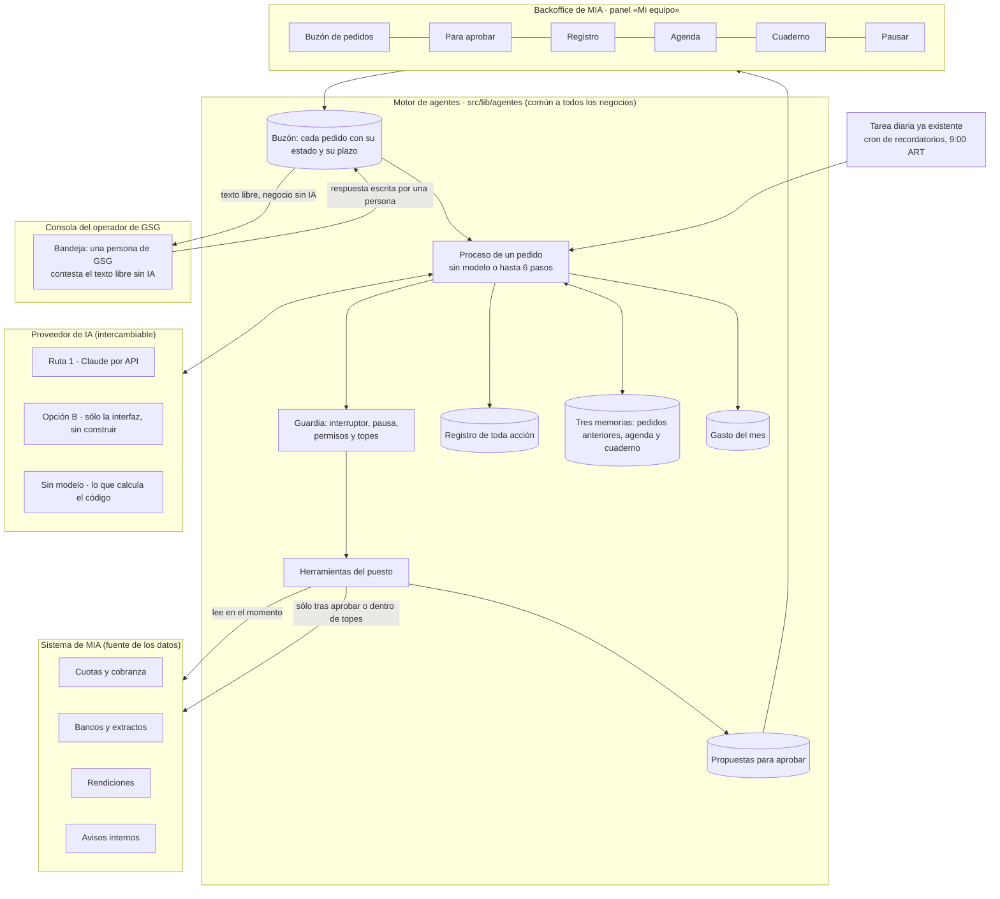
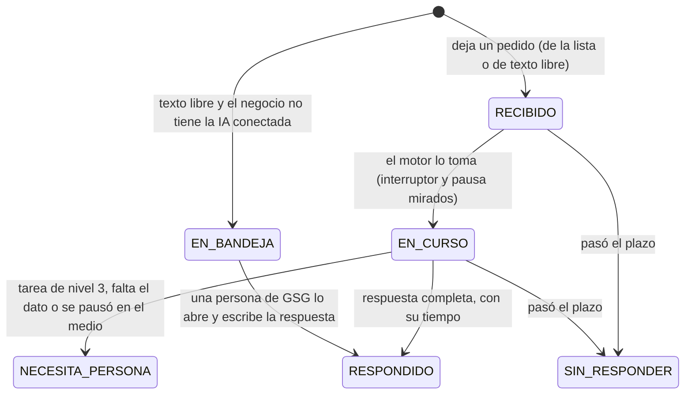
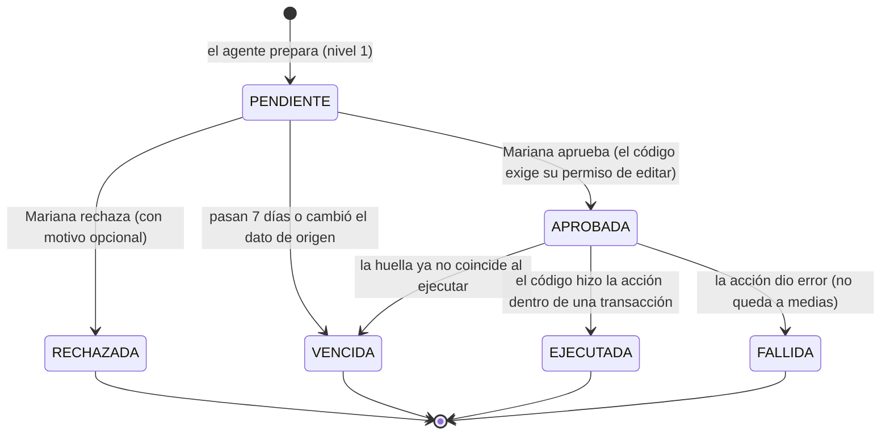

# Equipo de agentes de Administración · MIA Producciones — 01 · Solución y flujo

> Diseño del 14/11/2026 (orden del dueño). Sólo diseño: nada de esto está construido, desplegado ni aplicado a
> ninguna base. Decisiones de base: `docs/sectores/agencia-digital/analisis-mercado/2026-11-14-linea-agentes-ia-para-pymes.md`
> (§3, 5, 6, 10, 13, 14 y 15). Siguen: `02` funcional, `03` técnica, `04` tandas, `05` decisiones y supuestos.
> **Corregido el 14/11** tras la revisión adversarial y las decisiones del dueño de ese día: el detalle manda en `03`;
> la lista de cambios está en `05`, sección F. **Segunda corrección, mismo día** (`05`, sección G): no hay conversación
> en vivo sino un **buzón de pedidos** con respuesta en menos de 3 minutos (§5.1), y el equipo funciona sin modelo.
> **Ajuste final, 14/11 a la noche** (`05`, sección H): mientras un negocio no tenga la IA conectada, los pedidos
> escritos los contesta **una persona de GSG** desde una bandeja (§5.1).

## 1. Qué es, en una frase

Un equipo de cinco puestos que trabaja **dentro del backoffice de MIA**, lee los datos del sistema en el momento,
prepara el trabajo de administración y se lo deja a Mariana para aprobar con un toque. No mueve plata, no cierra
libros y no le escribe a nadie de afuera por su cuenta.

## 2. De dónde se parte (lo que existe hoy, leído en el código)

| Qué hay | Dónde | Qué le falta para esta línea |
|---|---|---|
| 7 agentes que sólo responden y preparan texto | `src/lib/proyectos/diseno-core.ts:294-344` | No tienen herramientas, memoria ni agenda |
| Agente «Administrador» (prepara, no mueve plata) | `diseno-core.ts:317-322`, instrucciones en `ia.server.ts:228` | Lee un resumen fijo (`ia.server.ts:279-285`), no consulta |
| Límite escrito en las instrucciones («no ejecutás nada») | `ia.server.ts:216-222` | El límite tiene que estar en el código, no en el texto |
| Conexión a la IA con dos proveedores (Claude y uno gratis) | `ia.server.ts:84-133`, `:33-37` | No pide herramientas ni cuenta consumo: la respuesta sólo lee `stop_reason` y `content` (`:126-132`) |
| La charla la guarda el navegador | `diseno-core.ts:359-374` | No hay historial en la base |
| Datos del negocio viajan escapados dentro de `<datos>` | `diseno-core.ts:377-385` | Se reutiliza tal cual |
| Permisos por rol y módulo | `gestion.server.ts:44-60`, `gestion-core.ts:645-651` | **Administración no ve los agentes de fábrica** (`ia: N`, `gestion-core.ts:648`; su barra no trae «Agentes IA», `:707`) |
| Cobranza con una sola cuenta | `cobranza-core.ts:370-384`, `empresa.server.ts:20-43` | Se lee con las mismas funciones: el agente da el mismo número que la pantalla |
| Conciliación a mano (atar movimiento y cuota, sin marcar pagada) | `acciones-empresa.ts:227-244` | Es la acción que el agente puede proponer |
| Avisos diarios desde una tarea programada | `vercel.json:8-17`, `src/app/api/cron/reminders/route.ts:31-37`, `avisos-programados.server.ts:14-27` | Es el único despertador: corre una vez por día |
| Interruptores por negocio, que sólo prende GSG | `src/cambios/interruptores.ts:9-20`, `:66` | Se suman dos, al final del catálogo: «equipo de agentes» y la IA para ese equipo (`03` §12) |
| WhatsApp entrante | `src/app/api/webhooks/whatsapp/route.ts:139-202` | Hoy atiende sólo pádel; no se usa en la primera versión |

## 3. Los puestos del equipo de Mariana y por qué

Salen de lo que Administración hace hoy en MIA: cobros y pagos sin tablero común y marcados proyecto por proyecto
(Factory-GSG `00-ESTADO/MIA-OPERACION-HOY.md` §3, dolor 6), y de lo que el sistema ya resuelve a mano.

| # | Puesto | Para qué | Por qué existe |
|---|---|---|---|
| 1 | **Coordinación** | Parte de la mañana, agenda del equipo, puerta de entrada cuando Mariana no sabe a quién preguntarle | El parte va incluido en cada puesto (§15 de las decisiones); un solo lugar para empezar el día |
| 2 | **Cobranzas** | Qué cuotas vencieron o vencen, recordatorio listo para cada cliente, promesas de pago anotadas y seguidas | Primer puesto acordado: «cobranza sin mover plata» |
| 3 | **Cuentas a pagar** | Qué hay que pagar esta semana contra el saldo de las cuentas, pagos sin factura cargada | Los pagos a proveedores hoy se miran evento por evento |
| 4 | **Bancos** | Proponer con qué cuota coincide cada movimiento del extracto | «Conciliación propuesta» de las decisiones; hoy se elige a mano |
| 5 | **Comprobantes** | Revisar rendiciones enviadas y preparar la carga de comprobantes | Va último y sólo «tras prueba medida» (§15, punto 6) |

No son cinco programas: es **un solo motor** con cinco configuraciones (instrucciones, herramientas, topes). El
equipo de Ale, que es el de **Dirección de MIA y vive en el mismo negocio** (decisión del dueño, 14/11), se arma con
otro archivo de puestos sobre el mismo motor (ver `03`, §2).

**Lo que el equipo no hace, nunca:** registrar cobros o pagos, pagar, emitir facturas, anular, registrar o
confirmar asientos, aprobar o reintegrar rendiciones, cambiar precios, borrar. Eso queda en una persona (nivel 3).

## 4. Nivel de permiso inicial por tarea

Niveles: 0 consulta · 1 prepara y una persona aprueba · 2 ejecuta solo dentro de topes fijos en el código ·
3 siempre una persona. «Techo» es lo máximo que el código permite; subir de nivel dentro del techo es decisión del
dueño, puesto por puesto, después de medir.

| Puesto | Tarea | Inicial | Techo | Qué pasa al aprobar o ejecutar |
|---|---|---|---|---|
| Coordinación | K1 Parte de la mañana | 2 | 2 | Deja el parte en el panel y un aviso interno. Sólo lee |
| Coordinación | K2 Avisar compromisos que vencen o vencieron | 2 | 2 | Aviso interno a quien lleva la plata |
| Coordinación | K3 Informe mensual | 2 | 2 | Queda en el panel. Sólo lee el registro |
| Cobranzas | C1 Consultar cobros | 0 | 0 | — |
| Cobranzas | C2 Preparar recordatorio de cobro | 1 | 1 (*) | Queda «listo para enviar»: Mariana lo copia o abre su WhatsApp o su mail. El sistema no envía |
| Cobranzas | C3 Anotar una promesa de pago o un seguimiento | 1 | 1 | La persona confirma con un botón en la respuesta del pedido y el sistema crea el compromiso con fecha (interno, se puede cancelar). La IA no lo crea sola (corrección del 14/11) |
| Cobranzas | C4 Marcar una cuota como cobrada | 3 | 3 | Deriva: deja el enlace a la cuota |
| Cuentas a pagar | P1 Consultar pagos | 0 | 0 | — |
| Cuentas a pagar | P2 Proponer los pagos de la semana | 1 | 1 | Guarda el plan aprobado como compromisos por fecha. No paga |
| Cuentas a pagar | P3 Avisar pagos sin factura cargada | 2 | 2 | Aviso interno |
| Cuentas a pagar | P4 Pagar o marcar pagado | 3 | 3 | Deriva |
| Bancos | B1 Consultar movimientos sin conciliar | 0 | 0 | — |
| Bancos | B2 Proponer conciliación | 1 | 1 (*) | Al aprobar, ata el movimiento a la cuota con la misma regla de hoy. No la marca pagada |
| Comprobantes | R1 Revisar rendiciones enviadas | 0 | 0 | — |
| Comprobantes | R2 Preparar la carga de un comprobante | 1 | 1 | Deja el borrador para que la persona lo confirme (tanda posterior) |
| Comprobantes | R3 Aprobar o reintegrar | 3 | 3 | Deriva |

(*) Subir el techo a 2 (enviar el recordatorio por el sistema, o conciliar sola la coincidencia exacta) no entra en
esta versión: es exposición a terceros o dato de plata, y queda como decisión del dueño (`05`, D3 y D10).

## 5. Arquitectura



Tres reglas de este dibujo:
1. **La IA no toca la base.** Sólo pide herramientas; el código decide si corren, con qué permisos y con qué tope.
2. **Los datos salen del sistema en cada vuelta** y las cuentas las hace el código (las mismas funciones que usan
   las pantallas). La IA escribe el texto que acompaña; los renglones con datos, sus fuentes y lo que sale hacia un
   cliente de MIA (el recordatorio) los arma el código (corrección del 14/11: `03` §4.2 y §13).
3. **Las memorias y el registro son tablas propias del negocio**, no del proveedor: cambiar de modelo no pierde nada.
4. **Por la bandeja de GSG sólo contesta una persona.** No hay proceso, rutina ni entrada automática que la vigile y
   responda; quién leyó y quién contestó queda en el registro del negocio (`03` §4.4).

### 5.1 Cómo se le pide algo al equipo: el buzón (decisión del dueño, 14/11)

«No vamos a hacer la conversación en vivo, pero vamos a hacer un buzón de mensajes para la gente. Con pedidos y con
respuestas menores a 3 minutos.»

La persona deja un pedido: lo elige de una lista corta de pedidos frecuentes del puesto o lo escribe. Lo ve en su
buzón con su estado, la hora en que lo pidió, la hora en que se respondió y la respuesta entera. No hay respuesta
palabra por palabra.



- **Objetivo de servicio: respuesta en menos de 3 minutos**, configurable por negocio. Se mide de verdad: el tiempo de
  cada pedido y el porcentaje dentro del objetivo van al registro y al parte.
- **Sin clave de API**, los pedidos de la lista se responden igual (los resuelve el código: cobranzas pendientes,
  vencimientos, parte del día). Los de texto libre van a la **bandeja de GSG**: la persona los ve como «Necesita una
  persona: lo responde alguien de GSG», una persona de GSG los abre en la consola del operador, escribe la respuesta y
  la manda, y aparece en el buzón como «Respondido por una persona de GSG». Se miden igual que los demás (tiempo, y
  dentro o fuera de los 3 minutos). Con clave y la IA prendida para ese negocio, los responde el motor con el modelo.
- **Ningún robot contesta por la bandeja:** sólo una persona con sesión en la consola (`03` §4.4).
- **Un pedido enviado dos veces es uno solo**, y cada persona tiene un tope de pedidos por día. El rescate de un
  pedido colgado lo hace sólo quien lo dejó, con sus propios permisos.
- Con el puesto en pausa o el equipo apagado no entra ningún pedido. Si se pausa mientras uno está en curso, se corta
  y queda «necesita una persona».
- Cómo se cumple el plazo y qué pasa cuando se vence: `03` §4.3.

## 6. Flujo de una tarea de punta a punta

Ejemplo: cuota vencida → recordatorio → promesa de pago → seguimiento.

```mermaid
sequenceDiagram
  autonumber
  participant T as Disparador (tarea diaria o Mariana)
  participant M as Motor
  participant S as Sistema de MIA
  participant IA as Proveedor de IA
  participant Ma as Mariana

  T->>M: «Revisá las cuotas vencidas»
  M->>M: Guardia: ¿interruptor prendido? ¿puesto activo? ¿hay saldo de gasto?
  M->>S: Lee cuotas vencidas (misma lectura que Administración)
  M->>M: Lee memorias: historial del cliente, compromisos abiertos, cuaderno
  M->>IA: Datos del sistema (marcados como datos) y el pedido
  IA-->>M: Pide herramienta «preparar recordatorio» (cuota X)
  M->>M: Valida argumentos, nivel de la tarea (1) y que la cuota sea de este negocio
  M->>S: Vuelve a leer la cuota y saca la huella
  M->>M: Guarda la propuesta PENDIENTE y lo anota en el registro
  M-->>Ma: Tarjeta «Para aprobar» con importe, vencimiento y texto
  Ma->>M: Aprobar (un toque)
  M->>S: Vuelve a comparar la huella (¿sigue impaga, mismo importe?)
  alt cambió mientras esperaba
    M-->>Ma: «Cambió desde que lo preparé: lo armo de nuevo»
  else sigue igual
    M->>M: Queda «listo para enviar» y se anota en el registro
    Ma->>Ma: Copia o abre su WhatsApp o su mail y lo manda ella
  end
  Ma->>M: Deja el pedido «Dijo que paga el viernes»
  M-->>Ma: Respuesta con la tarjeta «¿Anoto que paga el viernes?» (con botón)
  Ma->>M: Anotar
  M->>M: Crea compromiso con fecha (lo crea el código; tope de compromisos abiertos)
  Note over T,M: El viernes la tarea diaria despierta al puesto
  T->>M: Compromiso del día
  M->>S: ¿La cuota se cobró?
  alt se cobró
    M->>M: Cierra el compromiso como cumplido
  else sigue impaga
    M-->>Ma: Aviso interno y nueva propuesta de recordatorio
  end
```

## 7. Flujo de aprobación



Lo que garantiza el código, no las instrucciones:
- **Una propuesta se decide una sola vez.** Dos toques o dos personas a la vez: gana el primero y el segundo ve «ya
  estaba decidida» (mismo recurso que usa hoy la conciliación, `acciones-empresa.ts:239-240`).
- **Lo que se aprueba es lo que se ejecuta.** La tarjeta la arma el código con los datos de la base, no con el texto
  de la IA; los importes nunca salen de lo que escribió el modelo.
- **Aprueba una persona con permiso de editar ese módulo** (`exigirEditar`, `gestion.server.ts:56-60`). El agente
  no puede aprobarse.
- **Rechazar enseña:** el motivo puede guardarse en el cuaderno del puesto si Mariana lo marca.

## 8. Derivación a una persona

Deriva siempre que: la tarea es nivel 3, falta el dato («no lo tengo»), el importe no coincide, la persona lo pide,
se agotó el gasto del mes, o la IA no responde. Derivar = aviso interno a quien lleva la plata
(`usuariosDeLaPlata`, `gestion.server.ts:101-107`) con el enlace a la pantalla donde se resuelve, y registro.

## 9. Qué queda afuera de esta versión

WhatsApp como canal (entrada y salida), envío automático a clientes de MIA, lectura de fotos de comprobantes,
cualquier asiento contable, integraciones con sistemas de terceros (fuera del alcance de MIA por decisión del
dueño, Factory-GSG `00-ESTADO/MIA-ALCANCE-2026-11-08.md`, «Queda afuera»).
