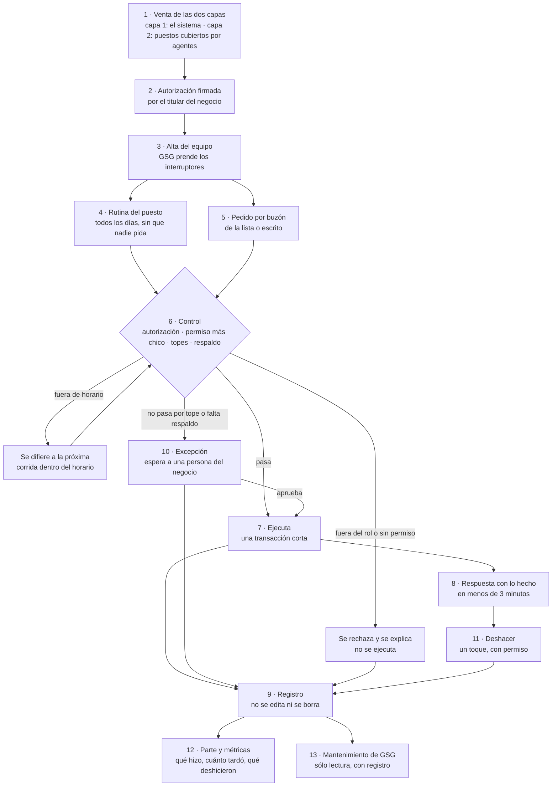
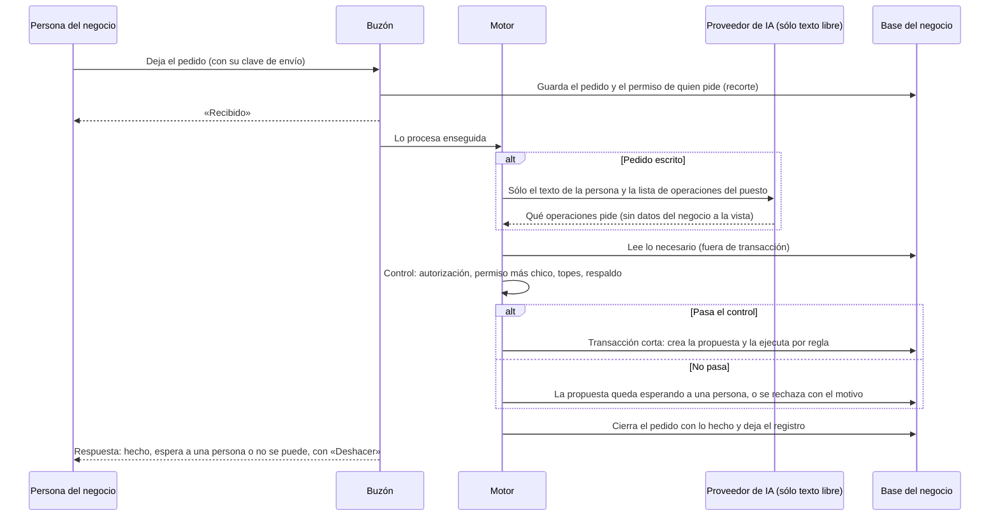
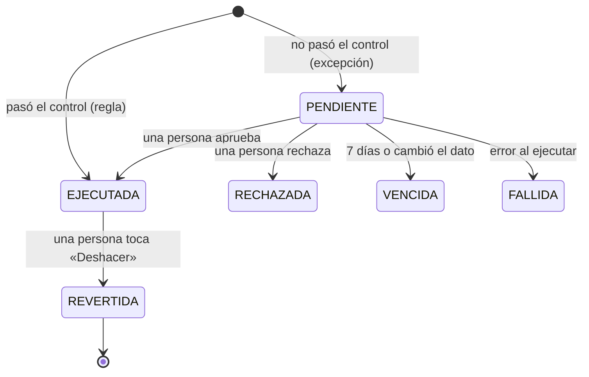
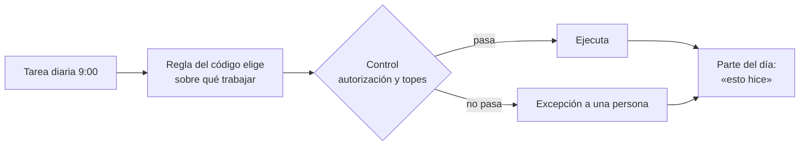

# Equipo de agentes de Administración · MIA — 07 · Flujo de trabajo completo (el agente transacciona)

> Diseño del 14/11/2026 (noche), **corregido el 15/11 por GSG-MIA-019** contra el dictamen de MIA-016
> (`desafio-mia016/dictamen-final.md`, commit `1506c9c0`). Tabla hallazgo → cambio en `11-correcciones-mia019.md`.
> **Manda sobre `01` a `05` donde se contradigan** (lista de secciones reemplazadas al final). Nada construido.
> Se monta encima de la tanda 1A (cerrada) y **sí la toca en un punto**: la migración `20261115120000_agentes_base`,
> todavía sin aplicar, recibe **una** enmienda (`desafio-mia016/esquema-final-enmienda.md`), con su brief propio
> (`12-brief-enmienda-esquema.md`), certificada antes del Gate 2. 1A no se reabre. Detalle funcional en `08`, técnico
> en `09`, plan de construcción en `13-plan-de-tandas-v3.md` (reemplaza a `10`).

## 1. Qué cambió, en palabras del dueño

- «el agente, tiene que contestar con la transacción hecha y sus tareas de trabajo del rol hechas.»
- «No solamente va a contestar el agente, sino que va a transaccionar.»
- El agente hace la rutina de su puesto «mientras la gente trabaja con sus tareas diarias» y se le pueden «agregar
  tareas particulares», «siempre con respecto a su rol».
- Cuando alguien le pide algo: «Vale el permiso más chico de los dos».
- El cliente firma una autorización. La bandeja con una persona es sólo la excepción.

El diseño anterior era «el agente prepara y una persona aprueba». El nuevo es: **el agente hace**, dentro de lo que
el cliente firmó y de los topes; una persona entra sólo cuando la operación queda afuera de eso.

## 2. Las tres reglas que ordenan todo

1. **Un solo camino de escritura.** Toda operación pasa por una propuesta (`AgentePropuesta`, `03` §7). Lo nuevo es
   quién la decide: si la operación está en la autorización firmada y pasa los controles, la decide **una regla del
   código** en el mismo momento; si no, queda esperando a una persona, como hoy. No hay un segundo camino.
2. **Tres llaves para que el agente haga algo solo:** (a) GSG prendió el interruptor de ejecución en ese negocio,
   (b) el cliente tiene una autorización firmada y vigente que nombra esa operación para ese puesto, y (c) el código
   permite que esa operación se ejecute sola (hay operaciones que no lo permiten nunca: `08` §3). Falta una: va a una
   persona. **Y una cuarta, del 14/11 (noche):** la operación tiene que estar **liberada** para ese negocio, después
   de pasar su batería de ataque (`08` §9, `09` §17). Sin liberar, tampoco se ejecuta sola. **Y una condición más
   para la plata (B2 y C4):** que GSG-MIA-018 (cobrar idempotente y conciliar sin carrera en el ERP de hoy) esté
   integrado y certificado. Hasta entonces B2 y C4 quedan con una persona, aunque estén firmadas.
3. **Todo lo que el agente hace solo sobre un dato del negocio se puede deshacer con un toque**, queda en el
   registro que el cliente ve y respeta los topes. Lo que no se puede deshacer queda siempre con una persona. La
   única excepción declarada son los **avisos internos** (etapa 0: parte, avisos a personas del propio negocio):
   un aviso no se retira; si estuvo mal, se manda otro que lo corrige (`08` §1).

## 3. El recorrido de punta a punta

| # | Paso | Qué pasa | Dónde está el detalle |
|---|---|---|---|
| 1 | Venta de las dos capas | El cliente ya usa el sistema (capa 1). Contrata puestos cubiertos por agentes (capa 2). Precio y contrato: fuera de este diseño | Handoff §1 |
| 2 | Autorización firmada | El titular del negocio lee y firma en el sistema qué puede leer y qué puede hacer cada puesto, con qué topes (sólo puede **bajar** los del catálogo), con vencimiento, y que el mantenimiento de GSG lee la base. Cómo firma (segundo factor, y ampliar con segunda confirmación y 24 h de espera) es **decisión del dueño**, con opción recomendada (`11` §3, D1). La firma sola no alcanza: hace falta además el interruptor de ejecución, que sólo prende GSG. Sin autorización vigente, el equipo sólo consulta **sin IA**: mientras no estén firmadas las partes 1 (lectura) y 5 (proveedor de IA), el código no llama al proveedor y GSG no lee | `08` §4 |
| 3 | Alta del equipo | GSG prende `equipo-agentes` (panel y buzón), `equipo-agentes-ia` (texto libre con IA) y `equipo-agentes-ejecuta` (que transaccione). Los tres apagados de fábrica | `09` §3 |
| 4 | Rutina del puesto | Cada mañana el puesto hace lo que le toca **sin plata** (etapas 0 y 1). La decide una regla del código, sin IA. La plata (B2, C4) **no corre como rutina**: cuando alguien sube un extracto, el sistema deja un pedido **a nombre de quien lo subió**, y vale el permiso más chico entre el agente y esa persona | `08` §2, `09` §9 |
| 5 | Pedido por buzón | Una persona deja un pedido: uno de la lista (con sus datos elegidos de listas) o uno escrito. No hay conversación en vivo | `03` §4.3 |
| 6 | Control | Autorización vigente, permiso más chico entre el agente y quien pide, topes, y respaldo de la operación (por ejemplo, el movimiento del banco) | `09` §5 a §7 |
| 7 | Ejecución | Una transacción corta por operación, con clave para no repetirla | `09` §4 y §8 |
| 8 | Respuesta | El pedido se cierra con la lista de lo hecho: qué cambió, de cuánto a cuánto, el enlace y «Deshacer». Plazo: 180 s en el camino feliz de un pedido de la lista; los casos que no entran están dichos en `08` §7 | `08` §5 |
| 9 | Registro | Una fila por cada cosa: lo que hizo, lo que no pudo, quién aprobó, quién deshizo | `03` §9 |
| 10 | Excepción | Lo que no pasó el control queda en «Para aprobar», con el motivo. Se le avisa a quien puede aprobar en el negocio | `08` §6 |
| 11 | Deshacer | Una persona con permiso toca «Deshacer»: el sistema hace la operación contraria y lo anota | `09` §8 |
| 12 | Parte y métricas | El parte del día cuenta lo que hizo el equipo; el panel muestra tiempos, operaciones, excepciones y deshechas | `08` §5 |
| 13 | Mantenimiento de GSG | GSG lee para mantener el servicio; no transacciona en el negocio del cliente. Cada lectura queda a la vista del cliente: **sin registro no hay lectura** | §7 de este documento |

## 4. Un pedido, paso a paso

El plazo es de 180 segundos, **condicionado** (corrige H15 del dictamen): vale para un pedido de la lista y para la
respuesta a un pedido escrito, con el proceso sin cortes, el proveedor respondiendo y dentro del horario. No vale
para lo diferido por horario (espera a la próxima corrida), ni para un proceso cortado mientras no haya despertador
por minuto (se retoma cuando alguien abre el buzón o en la tarea diaria), ni para lo que va a una persona. El p95
se mide en la batería (`09` §17) y el despertador es requisito para que una operación de etapa 2 salga sola (`09` §9). Un pedido
escrito que pide escribir algo **no ejecuta**: responde con el pedido de la lista ya armado, que la persona
confirma con un toque (`08` §2.2).

## 5. La vida de una operación

`REVERTIDA` es el único estado nuevo. Los demás ya están en `03` §3. Deshacer es, a su vez, una operación con su
propia fila (apunta a la que revierte): así queda quién deshizo, cuándo y con qué resultado (`09` §8).

## 6. La rutina del puesto

En la rutina no hay persona que pida: el permiso es el del agente, acotado por la autorización. **La rutina no usa
IA para decidir**: la decide el código con datos del sistema (importes, fechas, sentido). La IA, si está, sólo redacta
el párrafo del parte. **La rutina no mueve plata:** sobre la plata sólo avisa (candidatos sin conciliar, cobros con
respaldo pendientes). B2 y C4 corren sólo como pedido de una persona con permiso: el de la lista que alguien deja,
o el que el sistema deja a nombre de quien subió el extracto (corrige H4: quien sube el CSV no dispara la plata con
el permiso del agente).

## 7. Mantenimiento de GSG

- La autorización cubre que **GSG lea** la base del negocio para mantener el servicio. GSG **no transacciona** en el
  negocio del cliente y no aprueba sus excepciones.
- **Una sola forma de leer en esta versión:** por la consola del operador, con el patrón de Soporte (una transacción
  parada en ese negocio, `src/lib/operator-db.ts:37-46`), que deja una fila `LECTURA_GSG` a la vista del cliente.
  **Sin registro no hay lectura** (corrige H17): la sesión de operación de sólo lectura sobre la base queda fuera
  hasta que exista una forma de anotar cada lectura; crear un rol en la base es decisión del dueño.
- La lectura de GSG exige la parte 4 firmada y `lecturaOps` en la autorización viva.
- **Revocación por parte:** el titular saca sólo la lectura de mantenimiento (parte 4) firmando una **versión nueva
  que achica** (vale en el acto); las operaciones siguen. **Revocar todo** (un botón, lo puede apretar el titular o
  Dirección: frenar es siempre seguro) corta también la lectura; queda el soporte normal del sistema.
- Frenos de GSG sin publicar nada: apagar `equipo-agentes-ejecuta` (deja de transaccionar; sigue consultando) o
  `equipo-agentes` (apaga todo).

## 8. Quién hace qué

| Quién | Qué hace | Qué no hace |
|---|---|---|
| **Titular del negocio** (en MIA: quien figura como dueño de la cuenta) | Firma la autorización en la app (con segundo factor, si el dueño adopta la opción recomendada D1), firma una versión nueva para bajar topes (en el acto) o ampliarlos (segunda confirmación por mail y vigente 24 h después, con aviso a todos los dueños de la cuenta y a GSG), la revoca en el acto, entera o por parte | No puede prender la ejecución: eso es de GSG. No puede retirar una revocación ni pasar los topes del catálogo |
| **Dirección** (Ale) | Ve todo, aprueba excepciones, deshace, pausa puestos, revoca | — |
| **Administración** (Mariana) | Deja pedidos, aprueba excepciones de sus módulos, deshace, pausa | No firma la autorización ni cambia topes |
| **Otras personas del negocio** | Dejan pedidos si ven «Mi equipo»; el agente hace por ellas sólo lo que ellas mismas podrían hacer | No aprueban ni deshacen sin permiso de editar |
| **Agente de un puesto** | Rutina y pedidos de su rol: lee, ejecuta lo autorizado dentro de topes, responde, registra | Nada fuera de su rol; nada de la lista «siempre con una persona» (`08` §3); no cambia su propia autorización |
| **El código (motor)** | Decide si pasa el control, ejecuta, arma la respuesta y el registro, calcula importes | No obedece a un texto: sólo a reglas y a pedidos de personas con sesión |
| **Proveedor de IA** | Interpreta el pedido escrito y redacta texto | No decide permisos ni importes; no ve datos del negocio cuando interpreta qué operación se pide |
| **GSG · operador** | Prende y apaga interruptores, fija el tope de gasto de IA, atiende en la bandeja de GSG lo **derivado** (sobre el tope, irreversible o fuera del rol) y registra liberaciones con el expediente a la vista | No aprueba ni ejecuta operaciones del cliente; no firma por el cliente; no contesta el texto libre (lo contesta el agente); no resetea la clave del titular sin registro y aviso (y ese reset revoca la autorización viva) |
| **GSG · mantenimiento** | Lee para mantener, con registro | No escribe en el negocio |
| **Dueño de GSG** | Decide gasto (plan de Vercel), Gate 2, topes propuestos, textos legales, cada liberación y las decisiones abiertas de `11` §3. El proveedor de IA en prueba es tema cerrado: corre con el plan de Claude | — |

## 9. Qué pasa cuando algo falla

| Falla | Qué hace el sistema |
|---|---|
| El proveedor de IA no responde | Los pedidos de la lista y la rutina siguen (no usan IA). El pedido escrito se cierra como «Necesita una persona» con «Elegí un pedido de la lista». No hay segundo proveedor (decisión del dueño) |
| La función se corta a mitad | Si la operación ya se ejecutó, la clave impide repetirla; el pedido se retoma y muestra lo hecho. Sin despertador por minuto, se retoma cuando la persona abre su buzón (`09` §9) |
| Alguien pausa o GSG apaga en el medio | No se ejecuta nada más. Lo ya hecho queda hecho y a la vista |
| El cliente revoca la autorización | Corta en el acto: la próxima operación ya no pasa el control. Lo pendiente queda para una persona |
| Una operación salió mal | «Deshacer» la revierte. La detecta alguien que no es el agente: el control del código en la misma transacción (topes, respaldo exacto), K6 al día siguiente (código, no modelo), el parte diario a la persona y el muestreo de lo ejecutado revisado por una persona (`09` §17.5) |
| Se reseteó la clave del titular | La autorización viva queda revocada en el acto y se avisa a todos los dueños de la cuenta y a GSG (`08` §4) |

## 10. Qué queda reemplazado de `01` a `06`

No se reescriben. Donde digan otra cosa, vale este diseño.

| Documento | Sección | Qué pasa |
|---|---|---|
| `01` | §1, §3 (párrafo «Lo que el equipo no hace, nunca»), §4 (tabla de niveles), §7 (flujo de aprobación), §9 | Reemplazadas por `07` §2 a §5 y `08` §2 y §3. La aprobación de una persona pasa a ser la excepción |
| `02` | §1.1 a §1.5 (renglones «Tareas», «Acciones» y «Topes») | Reemplazados por el catálogo de `08` §2. «Lee», «Deriva a» y «Mide» siguen |
| `02` | §2 (pestaña «Para aprobar» y «Aprobar con un toque»), §3 (textos de aprobación), §6 (guion) | Se suman las pantallas, los textos y el guion de `08` §5 a §8. Lo de antes sigue para las excepciones |
| `03` | §4 (contrato: se suma `deshacer` y la operación), §6 punto 3, §7 («Decidir»: ahora también por regla), §8.1 primer punto (la promesa ya no espera un botón si la pidió la persona), §13 («sin ningún camino de escritura») | Reemplazadas o ampliadas por `09` §4 a §10. Las tres fases, la vigencia, el sólo lectura de `ctx.db`, el gasto y el registro **no cambian** |
| `03` | §4.4 | La bandeja de GSG **deja de ser el camino del texto libre** (lo contesta el agente) y queda para lo derivado: sobre el tope, irreversible o fuera del rol. GSG no aprueba operaciones. Nada de «copiar para Claude» (`13` §2, 1D) |
| `04` | Tandas 2 a 6 y sus briefs | Reemplazadas por `13-plan-de-tandas-v3.md` (que a su vez reemplaza a `10`) |
| `05` | D3 (recordatorio a terceros), D7 (quién aprueba), D10 (cuándo un puesto sube de nivel) | D10 se reemplaza por la autorización firmada. D3 y D7: `08` §3 y §6 |
| `06` | Entero | Sin efecto («Copiar para Claude» descartado). Sobreviven: el campo `recorte` de `AgentePedido`, el filtro de datos de terceros (C5) y el filtro de links, CBU y alias en toda respuesta (C7) |

## 11. Meta de lo que sale solo (corrige H13 del dictamen, lista §I.38)

La orden del dueño es que la persona en el medio sea la excepción. Se mide, no se supone:
- **Métrica del panel:** de las operaciones de etapa 1 y 2 que entran al motor, qué parte sale sola (`REGLA`), qué
  parte va a una persona y por qué motivo, por semana y por puesto.
- **Objetivo provisional a confirmar por el dueño:** 70 % solas a los 30 días de prender el equipo en el negocio. Si queda abajo,
  se revisa la condición que más deriva (por ejemplo, el nombre o CUIT del cliente en la descripción del banco, que
  no se verificó para MIA) antes de ampliar nada.
- **Antes de que C4 salga solo en MIA:** con un extracto real de MIA que el negocio cargue (sin consultas extra a
  la base), se cuenta cuántos movimientos cumplirían el respaldo exacto. Ese número va al expediente y al criterio
  de aceptación (`08` §7, criterio 32).
- Lo que siempre va a una persona por diseño (`08` §3) no cuenta como falla de la meta: se informa aparte.
