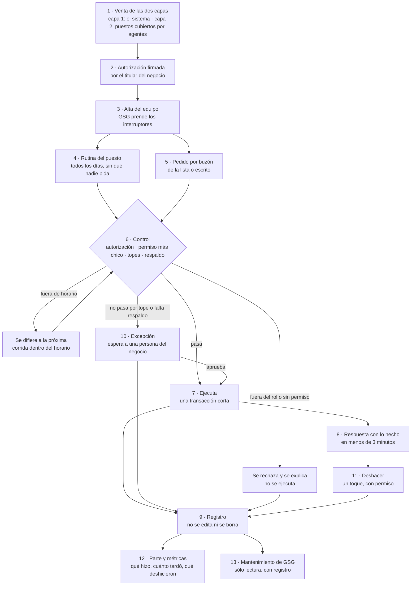
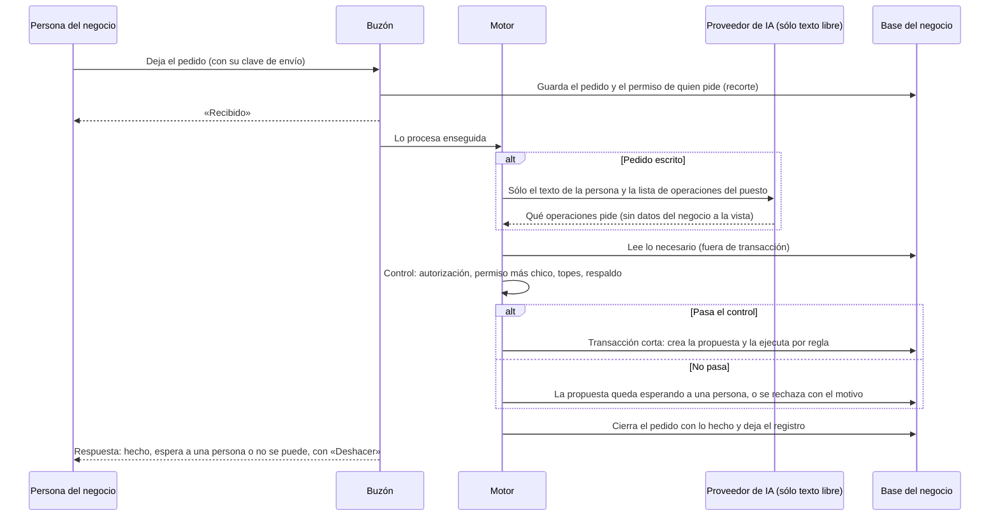
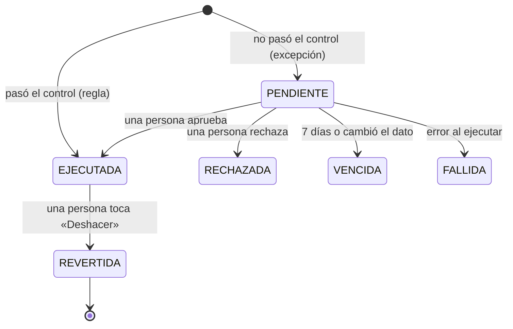
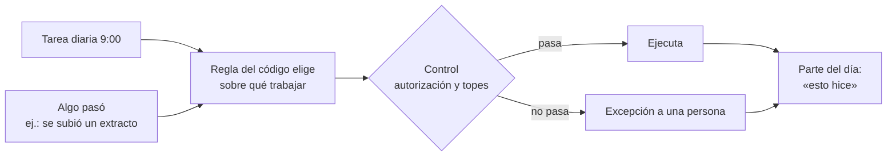

# Equipo de agentes de Administración · MIA — 07 · Flujo de trabajo completo (el agente transacciona)

> Diseño del 14/11/2026 (noche). **Manda sobre `01` a `05` donde se contradigan** (lista de secciones reemplazadas al
> final). Nada construido. Se monta **encima** de la tanda 1A (motor, buzón, 11 tablas, interruptores): no la cambia.
> Detalle funcional en `08`, técnico en `09`, plan de construcción en `10`.

## 1. Qué cambió, en palabras del dueño

- «el agente, tiene que contestar con la transacción hecha y sus tareas de trabajo del rol hechas.»
- «No solamente va a contestar el agente, sino que va a transaccionar.»
- El agente hace la rutina de su puesto «mientras la gente trabaja con sus tareas diarias» y se le pueden «agregar
  tareas particulares», «siempre con respecto a su rol».
- Cuando alguien le pide algo: «Vale el permiso más chico de los dos».
- El cliente firma una autorización. La bandeja con una persona es sólo la excepción.

El diseño anterior era «el agente prepara y una persona aprueba». El nuevo es: **el agente hace**, dentro de lo que
el cliente firmó y de los topes; una persona entra sólo cuando la operación queda afuera de eso.

## 2. Las tres reglas que ordenan todo

1. **Un solo camino de escritura.** Toda operación pasa por una propuesta (`AgentePropuesta`, `03` §7). Lo nuevo es
   quién la decide: si la operación está en la autorización firmada y pasa los controles, la decide **una regla del
   código** en el mismo momento; si no, queda esperando a una persona, como hoy. No hay un segundo camino.
2. **Tres llaves para que el agente haga algo solo:** (a) GSG prendió el interruptor de ejecución en ese negocio,
   (b) el cliente tiene una autorización firmada y vigente que nombra esa operación para ese puesto, y (c) el código
   permite que esa operación se ejecute sola (hay operaciones que no lo permiten nunca: `08` §3). Falta una: va a una
   persona.
3. **Todo lo que el agente hace solo se puede deshacer con un toque**, queda en el registro que el cliente ve y
   respeta los topes. Lo que no se puede deshacer queda siempre con una persona.

## 3. El recorrido de punta a punta

| # | Paso | Qué pasa | Dónde está el detalle |
|---|---|---|---|
| 1 | Venta de las dos capas | El cliente ya usa el sistema (capa 1). Contrata puestos cubiertos por agentes (capa 2). Precio y contrato: fuera de este diseño | Handoff §1 |
| 2 | Autorización firmada | El titular del negocio lee y firma en el sistema qué puede leer y qué puede hacer cada puesto, con qué topes, y que el mantenimiento de GSG lee la base. Sólo firma el titular. La firma sola no alcanza: hace falta además el interruptor de ejecución, que sólo prende GSG. Sin autorización vigente, el equipo sólo consulta | `08` §4 |
| 3 | Alta del equipo | GSG prende `equipo-agentes` (panel y buzón), `equipo-agentes-ia` (texto libre con IA) y `equipo-agentes-ejecuta` (que transaccione). Los tres apagados de fábrica | `09` §3 |
| 4 | Rutina del puesto | Cada mañana, y cuando pasa algo que la dispara (por ejemplo, alguien subió un extracto), el puesto hace lo que le toca. La decide una regla del código, sin IA | `08` §2, `09` §9 |
| 5 | Pedido por buzón | Una persona deja un pedido: uno de la lista (con sus datos elegidos de listas) o uno escrito. No hay conversación en vivo | `03` §4.3 |
| 6 | Control | Autorización vigente, permiso más chico entre el agente y quien pide, topes, y respaldo de la operación (por ejemplo, el movimiento del banco) | `09` §5 a §7 |
| 7 | Ejecución | Una transacción corta por operación, con clave para no repetirla | `09` §4 y §8 |
| 8 | Respuesta | El pedido se cierra con la lista de lo hecho: qué cambió, de cuánto a cuánto, el enlace y «Deshacer» | `08` §5 |
| 9 | Registro | Una fila por cada cosa: lo que hizo, lo que no pudo, quién aprobó, quién deshizo | `03` §9 |
| 10 | Excepción | Lo que no pasó el control queda en «Para aprobar», con el motivo. Se le avisa a quien puede aprobar en el negocio | `08` §6 |
| 11 | Deshacer | Una persona con permiso toca «Deshacer»: el sistema hace la operación contraria y lo anota | `09` §8 |
| 12 | Parte y métricas | El parte del día cuenta lo que hizo el equipo; el panel muestra tiempos, operaciones, excepciones y deshechas | `08` §5 |
| 13 | Mantenimiento de GSG | GSG lee para mantener el servicio; no transacciona en el negocio del cliente. Cada lectura queda a la vista del cliente | §7 de este documento |

## 4. Un pedido, paso a paso

El plazo sigue siendo 180 segundos para todo pedido, también el escrito (corrección del dueño; la enmienda 5 de `06`
quedó sin efecto).

## 5. La vida de una operación

`REVERTIDA` es el único estado nuevo. Los demás ya están en `03` §3. Deshacer es, a su vez, una operación con su
propia fila (apunta a la que revierte): así queda quién deshizo, cuándo y con qué resultado (`09` §8).

## 6. La rutina del puesto

En la rutina no hay persona que pida: el permiso es el del agente, acotado por la autorización. **La rutina no usa
IA para decidir**: la decide el código con datos del sistema (importes, fechas, sentido). La IA, si está, sólo redacta
el párrafo del parte.

## 7. Mantenimiento de GSG

- La autorización cubre que **GSG lea** la base del negocio para mantener el servicio. GSG **no transacciona** en el
  negocio del cliente y no aprueba sus excepciones.
- Dos formas de leer: (1) por la consola del operador, con el patrón de Soporte (una transacción parada en ese
  negocio, `src/lib/operator-db.ts:37-46`), que deja una fila `LECTURA_GSG` a la vista del cliente; (2) una sesión de
  operación de sólo lectura sobre la base. La segunda necesita un acceso de sólo lectura y una forma de anotar la
  lectura: **provisional a confirmar** (lo define la sesión de Plataforma; crear un rol en la base es decisión del
  dueño).
- Si el cliente revoca la autorización, GSG deja de leer datos del negocio (queda el soporte normal del sistema).
- Frenos de GSG sin publicar nada: apagar `equipo-agentes-ejecuta` (deja de transaccionar; sigue consultando) o
  `equipo-agentes` (apaga todo).

## 8. Quién hace qué

| Quién | Qué hace | Qué no hace |
|---|---|---|
| **Titular del negocio** (en MIA: quien figura como dueño de la cuenta) | Firma la autorización (sólo él, con su contraseña), firma una versión nueva para cambiar topes, la revoca en el acto | No puede prender la ejecución: eso es de GSG. No puede retirar una revocación |
| **Dirección** (Ale) | Ve todo, aprueba excepciones, deshace, pausa puestos, revoca | — |
| **Administración** (Mariana) | Deja pedidos, aprueba excepciones de sus módulos, deshace, pausa | No firma la autorización ni cambia topes |
| **Otras personas del negocio** | Dejan pedidos si ven «Mi equipo»; el agente hace por ellas sólo lo que ellas mismas podrían hacer | No aprueban ni deshacen sin permiso de editar |
| **Agente de un puesto** | Rutina y pedidos de su rol: lee, ejecuta lo autorizado dentro de topes, responde, registra | Nada fuera de su rol; nada de la lista «siempre con una persona» (`08` §3); no cambia su propia autorización |
| **El código (motor)** | Decide si pasa el control, ejecuta, arma la respuesta y el registro, calcula importes | No obedece a un texto: sólo a reglas y a pedidos de personas con sesión |
| **Proveedor de IA** | Interpreta el pedido escrito y redacta texto | No decide permisos ni importes; no ve datos del negocio cuando interpreta qué operación se pide |
| **GSG · operador** | Prende y apaga interruptores, fija el tope de gasto de IA, contesta pedidos escritos de negocios sin IA | No aprueba ni ejecuta operaciones del cliente; no firma por el cliente |
| **GSG · mantenimiento** | Lee para mantener, con registro | No escribe en el negocio |
| **Dueño de GSG** | Decide gasto (clave de la API, plan de Vercel), Gate 2, topes propuestos, textos legales | — |

## 9. Qué pasa cuando algo falla

| Falla | Qué hace el sistema |
|---|---|
| El proveedor de IA no responde | Los pedidos de la lista y la rutina siguen (no usan IA). El pedido escrito se cierra como «Necesita una persona» con «Elegí un pedido de la lista». No hay segundo proveedor (decisión del dueño) |
| La función se corta a mitad | Si la operación ya se ejecutó, la clave impide repetirla; el pedido se retoma y muestra lo hecho. Sin despertador por minuto, se retoma cuando la persona abre su buzón (`09` §9) |
| Alguien pausa o GSG apaga en el medio | No se ejecuta nada más. Lo ya hecho queda hecho y a la vista |
| El cliente revoca la autorización | Corta en el acto: la próxima operación ya no pasa el control. Lo pendiente queda para una persona |
| Una operación salió mal | «Deshacer» la revierte. La rutina de control del día siguiente avisa si algo de lo hecho dejó de cuadrar (`08` §2, K6) |

## 10. Qué queda reemplazado de `01` a `06`

No se reescriben. Donde digan otra cosa, vale este diseño.

| Documento | Sección | Qué pasa |
|---|---|---|
| `01` | §1, §3 (párrafo «Lo que el equipo no hace, nunca»), §4 (tabla de niveles), §7 (flujo de aprobación), §9 | Reemplazadas por `07` §2 a §5 y `08` §2 y §3. La aprobación de una persona pasa a ser la excepción |
| `02` | §1.1 a §1.5 (renglones «Tareas», «Acciones» y «Topes») | Reemplazados por el catálogo de `08` §2. «Lee», «Deriva a» y «Mide» siguen |
| `02` | §2 (pestaña «Para aprobar» y «Aprobar con un toque»), §3 (textos de aprobación), §6 (guion) | Se suman las pantallas, los textos y el guion de `08` §5 a §8. Lo de antes sigue para las excepciones |
| `03` | §4 (contrato: se suma `deshacer` y la operación), §6 punto 3, §7 («Decidir»: ahora también por regla), §8.1 primer punto (la promesa ya no espera un botón si la pidió la persona), §13 («sin ningún camino de escritura») | Reemplazadas o ampliadas por `09` §4 a §10. Las tres fases, la vigencia, el sólo lectura de `ctx.db`, el gasto y el registro **no cambian** |
| `03` | §4.4 | La bandeja de GSG sigue sólo para el texto libre de negocios sin IA. GSG no aprueba operaciones |
| `04` | Tandas 2 a 6 y sus briefs | Reemplazadas por `10` |
| `05` | D3 (recordatorio a terceros), D7 (quién aprueba), D10 (cuándo un puesto sube de nivel) | D10 se reemplaza por la autorización firmada. D3 y D7: `08` §3 y §6 |
| `06` | Entero | Sin efecto («Copiar para Claude» descartado). Sobreviven: el campo `recorte` de `AgentePedido`, el filtro de datos de terceros (C5) y el filtro de links, CBU y alias en toda respuesta (C7) |
